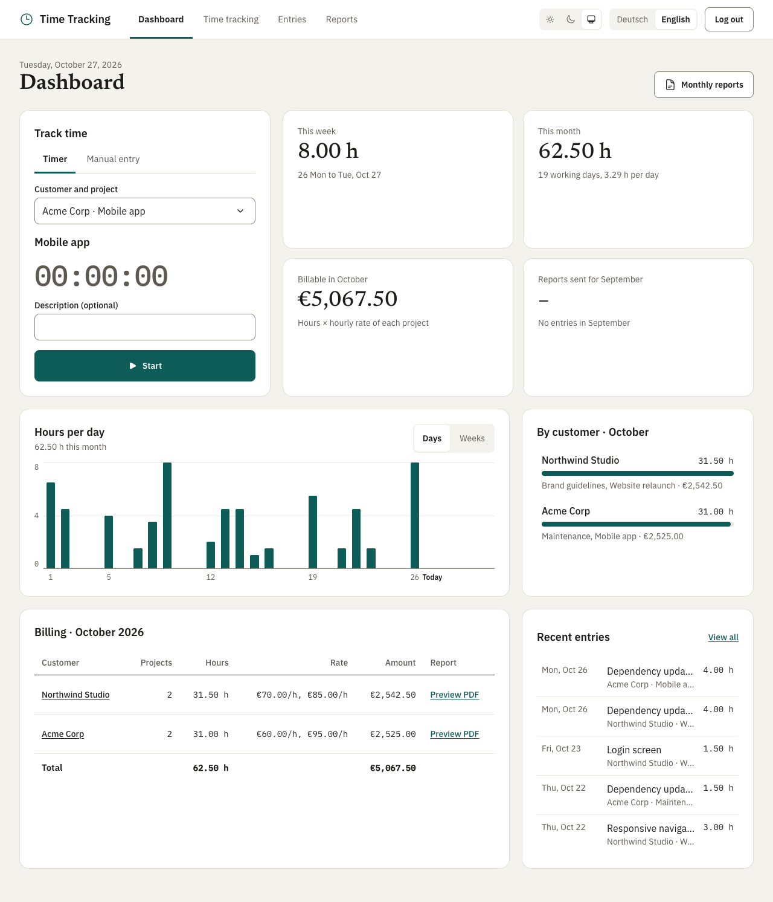

# Dashboard

The Dashboard is the start page: the app opens on it, and it is the first item in the header navigation (*Dashboard*,
*Time tracking*, *Reports*; the German name is also *Dashboard*). It shows the current month across all customers and
lets you track time without choosing a customer first.

The design comes from a mockup (kept locally in `mockups/`, not in git). The app's design system replaces the mockup's
colors and heading font; see [Design](design.md).

## Layout

- **Header:** today's date, the page heading and **Monthly reports**, which opens the Reports page.
- **Row 1:** *Track time* next to four key figures.
- **Row 2:** the hours chart next to *By customer*.
- **Row 3:** the billing table next to *Recent entries*.

Below 1024 px (`lg`) each row stacks.

## Track time

A card with two tabs, *Timer* and *Manual entry* (German: *Nachtragen*). The tabs follow the WAI-ARIA tabs pattern
(`components/Tabs.jsx`): one tab stop, the arrow keys, Home and End switch tabs. Both panels stay mounted, so a typed
description survives switching.

- **Timer, stopped:** a *Customer and project* select (all projects as "Customer · Project", preselected with the
  project of the newest entry), the description and **Start**.
- **Timer, running:** the customer, the project, *Running since 09:12*, the clock and **Stop**. It is the same timer as
  in the header (App's `useActiveEntry`), so stopping in one place stops both. After stopping, the card confirms
  *Saved 1.50 h to Website.*
- **Manual entry:** the existing entry form (`EntryForm`): project, date, start, end and description, then **Add**.
  The mockup's decimal hours field was not built; entries keep real start and end times.

Without any project, the card asks to add a customer and a project on the Time tracking page first.

## Key figures

| Figure | Meaning |
|---|---|
| This week | Hours Monday to today, including days of the previous month |
| This month | Hours this month, with the number of working days (Monday to Friday) so far and the average per working day |
| Billable in *month* | Hours × the hourly rate of each project |
| Reports sent for *last month* | Reports with status *Sent* out of all customers with entries last month; "–" without any |

Running entries count 0 hours everywhere, as in the rest of the app.

## Hours chart

Bars for the month, with a **Days / Weeks** switch (buttons with `aria-pressed`).

- **Days:** one bar per day, scale 0 to 8 h (higher when a day has more). Labels on the 1st, on Mondays and *Today*.
- **Weeks:** one bar per calendar week touching the month (ISO week numbers), counting only that month's days; scale 0
  to 40 h. Labels *Week 36* plus the date range, the current week as *This week*.
- Next to the title, a readout shows the month total. Hovering a bar shows its value there instead (*Mon, Sep 21:
  1.50 h*; future days read *upcoming*).
- **Keyboard and screen readers:** the bars are one tab stop (a group named *Bars, use the arrow keys to read the
  values*). The arrow keys, Home and End move between bars and update the readout, which is a polite live region. A
  visually hidden table (*Hours per day, September 2026*) lists every value.

## By customer

Hours per customer this month as horizontal bars, most hours first, with the projects and the amount. Selecting a
customer opens it on the Time tracking page. The bar is decorative; screen readers read the customer's share of all
hours of the month after the hours (*70 % of total*).

## Billing

A table for the current month: customer, number of projects, hours, hourly rate(s), amount and **Preview PDF**, plus a
total row. The customer name opens the customer on the Time tracking page. **Preview PDF** opens the month's report as
a PDF in a new tab (its accessible name says so). The preview is always hours only: the Reports page's choice to show
hourly rates and amounts does not apply to it, and the amounts in the Dashboard are separate from that choice.

Below the table, a notice lists last month's reports that are not sent yet (*August: 1 of 2 reports sent.*), each with
its status (*draft*, *ready to send*) and **Open report**, which opens the Reports page with that customer and month.
The status is set on the Reports page; see [Reports](reports.md).

## Recent entries

The last five finished entries of all customers: day, description, customer · project, hours. Selecting one opens its
customer and project on the Time tracking page; **View all** opens the customer of the newest entry.

## Data

One request, `GET /api/dashboard` (see [Dashboard API](../backend/dashboard.md)), loads the entries of the month and
the current week, the recent entries, all projects and last month's report statuses. `dashboard.js` calculates all
sums in the browser, reusing `summarize` and `projectsOf` from `summary.js`. The page loads again after a manual entry
and whenever the timer starts or stops (also from the header). The date is taken when the page opens.

## Code

- `frontend/src/pages/Dashboard.jsx`: loading, layout, page switches
- `frontend/src/components/dashboard/`: `TrackTimeCard`, `KeyFigures`, `HoursChart`, `ByCustomer`, `BillingTable`,
  `RecentEntries`
- `frontend/src/components/Tabs.jsx`: accessible tabs
- `frontend/src/dashboard.js`: weeks, days, working days, per-customer sums
- `routes.js`: `trackingPath(customerId, projectId)` and `reportPath(customerId, year, month)` build the addresses the
  Dashboard's links go to (see [Navigation and addresses](navigation.md))

Tests (in `frontend/tests/`): `dashboard.test.js`, `pages/Dashboard.test.jsx`, `components/Tabs.test.jsx`, and the page flows in
`App.test.jsx`.

## Not built yet

- The mockup's decimal *hours so far* next to the start time of a running timer.
- Reports for the current month cannot be sent before it ends; the dashboard doesn't say so ("Reports unlock on …").
