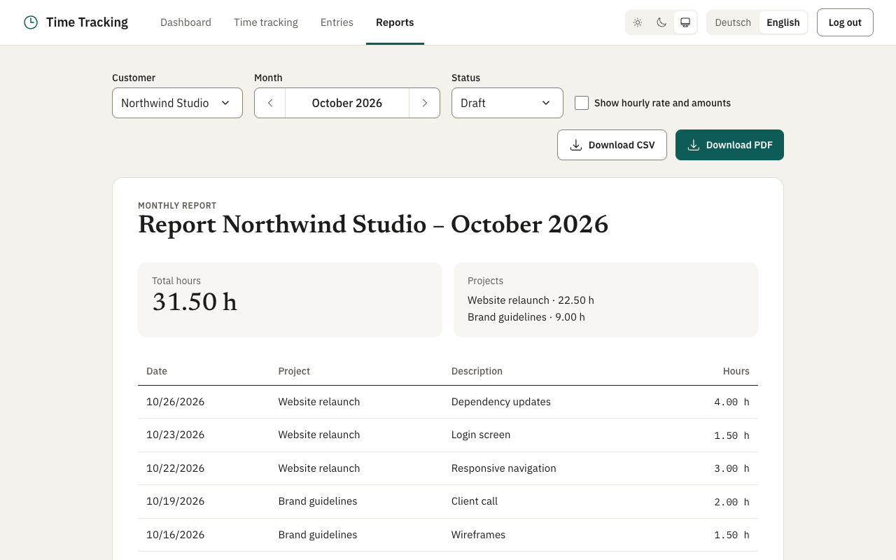

# Reports

The **Reports** page (German: **Berichte**) shows a customer's time entries of one month and downloads them as a PDF or a CSV file.

## Using it

1. Select a customer. The report of the current month loads right away.
2. Change the month with the arrow buttons (*Previous month*, *Next month*); they cross the turn of the year. Each
   change loads the report again. The month name follows the language.
3. **Show hourly rate and amounts** (German: **Stundensatz und Beträge anzeigen**) is a checkbox in the filter row,
   shown as soon as a customer is chosen, also for a month without entries.
   - It starts from the setting **Show hourly rate and amounts in reports** ([Settings](settings.md)), which is **off by
     default**: the report then lists hours only. Ticking it loads the report again with the amounts (a brief
     *Loading...*; the checkbox stays in place and keeps focus) and adds them to the downloads below.
   - A change of the checkbox counts for this visit of the page only, for every customer and month you open meanwhile:
     it does not change the setting and is not remembered. It is a way of looking at the report, not part of it, so the
     report status is not affected.
   - The report loads as soon as the settings are known (`App` loads them once, so this is normally at once). If they
     could not be loaded, the page shows the error with **Try again**, falls back to no amounts and follows the setting
     as soon as a retry succeeds, as long as the checkbox was not touched. The button stays in place while it loads
     (`hooks/useRetry.js`, also used by the Settings page), so keyboard focus is kept and the report on screen is not
     loaded again if the retry fails.
   - The choice the browser used to remember (`localStorage`, key `reportAmounts`) has no effect any more and is removed
     when the page opens.
   - What the screen shows: see [The report](#the-report).
4. **Download PDF** downloads the same report as a PDF, in the language the UI currently uses, with or without amounts,
   as the checkbox says. It is only shown when the month has entries.
   - The PDF is loaded in the background first: if that fails, the page stays and shows *PDF could not be downloaded.*
     (`role="alert"`) instead of replacing the app with the server's error.
   - The file keeps the name the backend gives it (`Content-Disposition`), e.g. `abrechnung-Muster GmbH-2026-9.pdf`.
     See [Reports API](../backend/reports.md).
5. **Download CSV** (German: **CSV herunterladen**), next to it, downloads the same entries as a CSV file for
   spreadsheets: date, start, end, customer, project, description and hours per entry, plus the hourly rate and the
   amount when the checkbox is ticked.
   - The file follows the language: German uses `;` between the columns and a decimal comma (`1,50`), English uses `,`
     and a decimal point (`1.50`), so it opens correctly in Excel set to that language.
   - If a download fails, the page shows *CSV could not be downloaded.* (`role="alert"`). While a download runs, both
     buttons are marked disabled (`aria-disabled`) and ignore clicks, so only one download runs at a time.
     Details: [Reports API](../backend/reports.md#csv-export).
6. **Status** (*Draft*, *Ready to send*, *Sent*; German: *Entwurf*, *Bereit zum Versand*, *Verschickt*) records where
   the report of this customer and month stands. Changing it saves right away; if saving fails, the select keeps the
   old status and an error shows. Only shown when the month has entries. The Dashboard counts the sent reports of the
   previous month and lists the others. See [Reports API](../backend/reports.md#report-status).

The customer and the month are in the address (`/reports/3/2026-09`, see [Navigation and addresses](navigation.md)):
choosing a customer adds a history entry, the month arrows replace it, and a reload or a bookmark opens the same report.
Without a month in the address, the current one opens. An address with a customer that does not exist shows *This
customer does not exist (any more).* with a link back, and a month that is none (`/reports/3/foo`) is *Page not found*.
The month arrows are marked disabled (`aria-disabled`) until a customer is chosen.

**Open report** (a link) in the month summary on the Time tracking page opens this page with that customer. On the
Dashboard, **Monthly reports** opens it without a customer, and **Open report** in the billing notice opens it with the
customer and last month.

Months follow the browser's time zone: the page sends it with the request, so an entry started at 00:30 on the 1st
belongs to that month, as on the Dashboard and the Time tracking page. See [Reports API](../backend/reports.md#time-zone).

While a report loads, the previous one is hidden and the page says *Loading...*, so an old report never shows under a
new customer or month.

## The report

- The heading reads *Report Muster GmbH – September 2026* (German: *Abrechnung Muster GmbH – September 2026*).
- *No entries for this period* when the month is empty.

**Option off (default):**

- Two figures: **Total hours** and **Projects** (project name and hours).
- A table with date, project, description and hours per entry, and a **Total** row for the hours. No amounts anywhere.

**Option on:**

- Three figures: **Total hours**, **Amount (net)** and **Projects**, where each project line reads
  `Website · 12,00 h · 80,00 €/h · 960,00 €`.
- The table has an **Amount** column, and the **Total** row shows the total amount.

The hours are the same in both modes and equal what the PDF prints: each entry's hours are rounded to hundredths, a
running entry counts as 0 h, and the totals add up those rounded values. All money comes from the backend
(`amounts=1`, see [Reports API](../backend/reports.md#amounts)); the page never multiplies hours by rates, so the screen,
the PDF and the CSV show the same numbers. Amounts are in euros. `summary.js` (hours times rate, as floats) is still used
by the Dashboard but no longer by this page.

Project lines count an entry that ends before it starts as 0 hours, like the server does for amounts, so they can add up
to more than the total, which keeps such an old entry's negative hours (how to find and fix them: [Time entries](../backend/time-entries.md#entries-that-end-before-they-start)). The Dashboard's **Preview PDF** stays hours only.

## Formats

Dates, hours and amounts follow the language: `2.3.2026`, `1,50 h` and `142,50 €` in German, `3/2/2026`, `1.50 h`
and `€142.50` in English.

## Code

`frontend/src/pages/Reports.jsx` (gets `settings` from `App`; `amountsChoice` is `null` until the checkbox is touched, so
it follows the setting), `reportOptions.js` (`forgetStoredShowAmounts()` removes the old stored choice), `api.js` (`getMonthlyReport`, `downloadPDF`,
`downloadCSV`, each with an `amounts` argument that adds `&amounts=1` only when true), `format.js`. Tests (in
`frontend/tests/`): `pages/Reports.test.jsx`, `api.test.js`, `reportOptions.test.js`.
